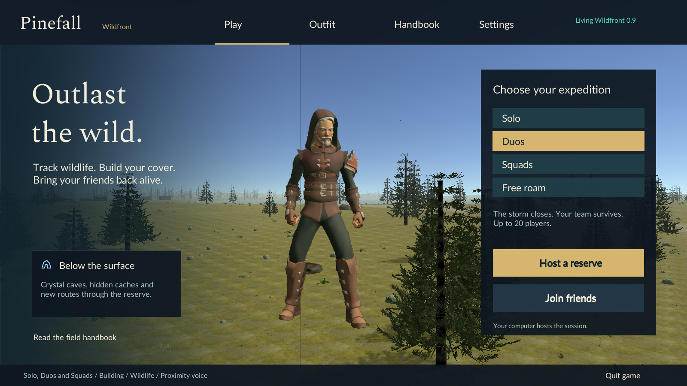
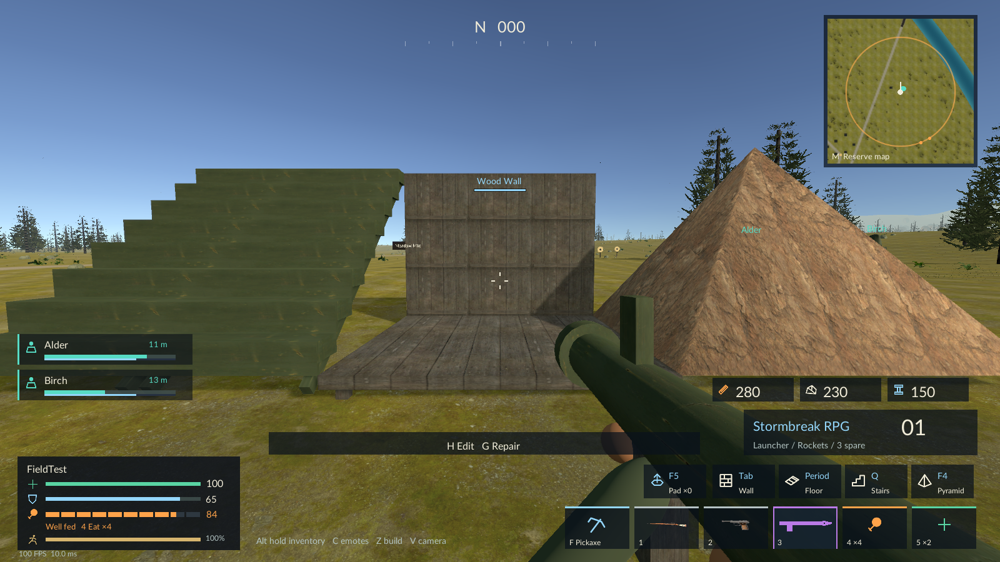

# Pinefall Wildfront

**A host-your-own multiplayer wilderness battle royale built in Unity.** Hunt to survive, scavenge named settlements, upgrade your equipment, and travel by road or water as the storm closes.



**Current source baseline:** 0.9.0 · **Unity:** 2022.3.13f1 · **Player target:** Windows x64 · **Network protocol:** 9 · **Players:** up to twenty, including practice bots.

**Closeout status:** compiled development candidate. See [verification and remaining issues](docs/VERIFICATION-0.9.md), including the remaining performance regression and incomplete final rerun.

This repository contains the editable game, imported assets, generated scene, pinned packages, and collaboration tooling. Open the repository root in Unity Hub. The game is playable and still in development; character art, animation, vehicle handling, balance, and online infrastructure have room to improve.

## Get the project running

1. Install **Unity 2022.3.13f1** through Unity Hub, including **Windows Build Support (Mono)**. An activated Unity license is required for editor/build use.
2. Clone this repository:
   ```sh
   git clone https://github.com/SamuilNikolov/Pinefall.git
   cd Pinefall
   ```
3. In Unity Hub, choose **Add project from disk** and select this folder, containing `Assets`, `Packages`, and `ProjectSettings`.
4. Allow Package Manager and asset imports to finish. Open `Assets/Scenes/Reserve.unity`, press Play, and choose **Host a game**.
5. To create a standalone player, choose **Pinefall → Build current scene**. The default output is `Builds/Windows/Pinefall.exe` inside the checkout. Keep the executable and its companion files together.

Use **Build current scene** for ordinary development. **Build playable demo** and **Rebuild reserve scene** regenerate authored/generated scene content and can overwrite scene edits. See [setup and build instructions](docs/SETUP.md) before using them.

The first clone is substantial because the imported source art, extracted animation clips, 4K atlas and generated Unity scene are included. Git LFS is not required for this baseline. `Library`, builds and local test output are excluded.

## What is here

| Area | Current functionality |
| --- | --- |
| Match | Solo, duo and squad teams; practice bots; lobby/readiness; per-player spawn bidding and free-point landing; shrinking storm stages; downing, revives and victory |
| World | 6,144 m square reserve; six core biomes plus an autumn floodplain variant; 60 named settlements, 444 searchable buildings, 89 road links, six branching cave systems, five lakes |
| Equipment | Eight weapon classes including a projectile RPG, rarity-based loot, three attachment categories with nine mods, slot inventory, shareable drops, armor, hunger, food and healing |
| Travel | 112 starting vehicles including motorcycles and boats; condition, fuel, repairs and boost; live vehicle map icons |
| Wildlife | Biome-based populations; peaceful prey and predators; storm aggression and larger alpha mutations; food and usable equipment rewards; swimming sharks |
| Construction | Pickaxe harvesting, wood/stone/metal, player-relative replicated walls/floors/stairs/pyramids, cell editing, doors, repairs, support collapse and floor-mounted launchpads |
| Combat | Stance-aware anatomical hit regions, bounded server rewind, confirmed damage feedback, class-specific firing/range, team-aware spectating |
| Presentation | First/third person, character options, weather and five-minute day cycle, map zoom/labels, recorded sound banks, event narration, opt-in proximity voice |
| Performance | Cached terrain sampling, sleeping parked vehicles, bounded distant simulation, visual/network work budgets, cached HUD icons and hardware-independent automatic detail |



Read the [player handbook](GAME-GUIDE.md) for rules and controls. These are current development features, not a promise that every asset or mechanic is production finished.

Read the [Living Wildfront update](docs/LIVING-WILDFRONT.md) for lobby-sized arenas, launchpads, caves, equipment rewards and the visual budgets.

## Join a game

The host's session card shows its address and **UDP 7777** by default. LAN guests can use discovery or the host's local IPv4 address. Internet guests need the public IPv4 address, a reachable forwarded UDP port and an executable-specific firewall allowance. There is **no relay or account service**. A displayed public address does not prove reachability; carrier-grade NAT and double NAT can require another approach. See [networking](docs/NETWORKING.md).

**All friends must use 0.9 builds.** Protocol 9 adds arena, build-frame, launchpad and glider state. Earlier clients are incompatible. Local automation uses separate ports and never needs your router settings.

## Start contributing

| You want to… | Read this |
| --- | --- |
| Import, run and build | [Setup](docs/SETUP.md) |
| Understand the building and combat systems | [Fieldcraft update](docs/FIELDCRAFT.md) |
| Understand the code and scene | [Architecture](docs/ARCHITECTURE.md) and [system/file map](docs/SYSTEMS.md) |
| Continue work as an AI agent | [AGENTS.md](AGENTS.md), then [current handoff](docs/HANDOFF.md) |
| Add a gun, animal, settlement, biome or vehicle | [Content extension recipes](docs/CONTENT.md) |
| Change networking or multiplayer rules | [Authority, visibility and protocol](docs/NETWORKING.md) |
| Run gameplay checks or compare frame rate | [Testing](docs/TESTING.md) and [performance engineering](docs/PERFORMANCE.md) |
| Submit changes | [CONTRIBUTING.md](CONTRIBUTING.md) and [development workflow](docs/DEVELOPMENT.md) |
| Choose the next improvement | [Roadmap and known limits](docs/ROADMAP.md) |
| Understand third-party content | [Asset workflow](docs/ASSETS.md), [notices](THIRD-PARTY-NOTICES.md) and [licensing status](LICENSE.md) |

```text
Pinefall/
├── Assets/                  # Importable Unity project, including stable .meta GUIDs
│   ├── Editor/              # Scene/prefab/content generators and build entry points
│   ├── Scripts/             # Gameplay, networking, presentation, opt-in probes
│   ├── Scenes/Reserve.unity # Committed playable scene
│   ├── Resources/           # Runtime-loaded prefabs, clips, textures and audio
│   ├── Generated/           # Committed generated terrain/material data
│   └── Art/                 # Imported source models, textures and fonts
├── Packages/                # Manifest and resolved package lock
├── ProjectSettings/         # Editor version, serialization, build and input settings
├── docs/                    # Engineering guides, handoff, decisions and screenshots
├── tools/                   # Portable build/test/repository scripts
├── tests/baselines/0.7.1/    # Historical reports; not a substitute for a fresh test run
└── .github/                 # Repository-check CI and contribution templates
```

## Validation history

The 0.8 build passed **219 gameplay assertions** across fourteen reports, including four-player Fieldcraft/late-join checks. Native UI was inspected at 1600×900 and 1280×720. A rendered host with two clients averaged **102.5–118.5 FPS** in HUD-on scenes at 1600×900 on one i5-13450HX / RTX 4060 Laptop. See [0.8 verification](docs/VERIFICATION-0.8.md) for frame-time tails, build hashes and limits. Physical microphones and public-internet conditions remain human playtests. Historical results below describe the older build.

The 0.7.1 Windows player passed **146 gameplay assertions** and **32 cross-version compatibility assertions** on October 25, 2026. Graphics-enabled host tests with two clients averaged **89–99 FPS** across the sampled scenes at 1600×900 on one i5-13450HX / RTX 4060 Laptop system. See [the original performance report](PERFORMANCE.md), [verification](VERIFICATION.md), and [stored evidence](tests/baselines/0.7.1/README.md) for procedure and limits. Other hardware and public-internet play remain unverified.

The GitHub workflow checks repository integrity and documentation. It does **not** claim to compile Unity or run multiplayer tests without a licensed editor. Local build and test commands are in [tools/README.md](tools/README.md).

This collaboration-ready checkout was also imported and built from scratch, then passed a **fresh 146-assertion run** through the included scripts. See [repository verification](docs/REPOSITORY-VERIFICATION.md).

## Project status and licensing

The 0.8 update builds on the tested 0.7.1 reserve, retaining its static terrain, art, atlas, content IDs and performance budgets. See [Fieldcraft](docs/FIELDCRAFT.md) for the new construction, combat, voice and UI boundaries. Existing source files include compact formatting and several partial classes; [the roadmap](docs/ROADMAP.md) describes a gradual path to clearer modules.

The repository owner has not selected a project-wide open-source license. Do not assume MIT or apply a blanket license to third-party assets. See [LICENSE.md](LICENSE.md); credits and source selections are retained in [THIRD-PARTY-NOTICES.md](THIRD-PARTY-NOTICES.md) and [AUDIO-SOURCES.json](AUDIO-SOURCES.json).
