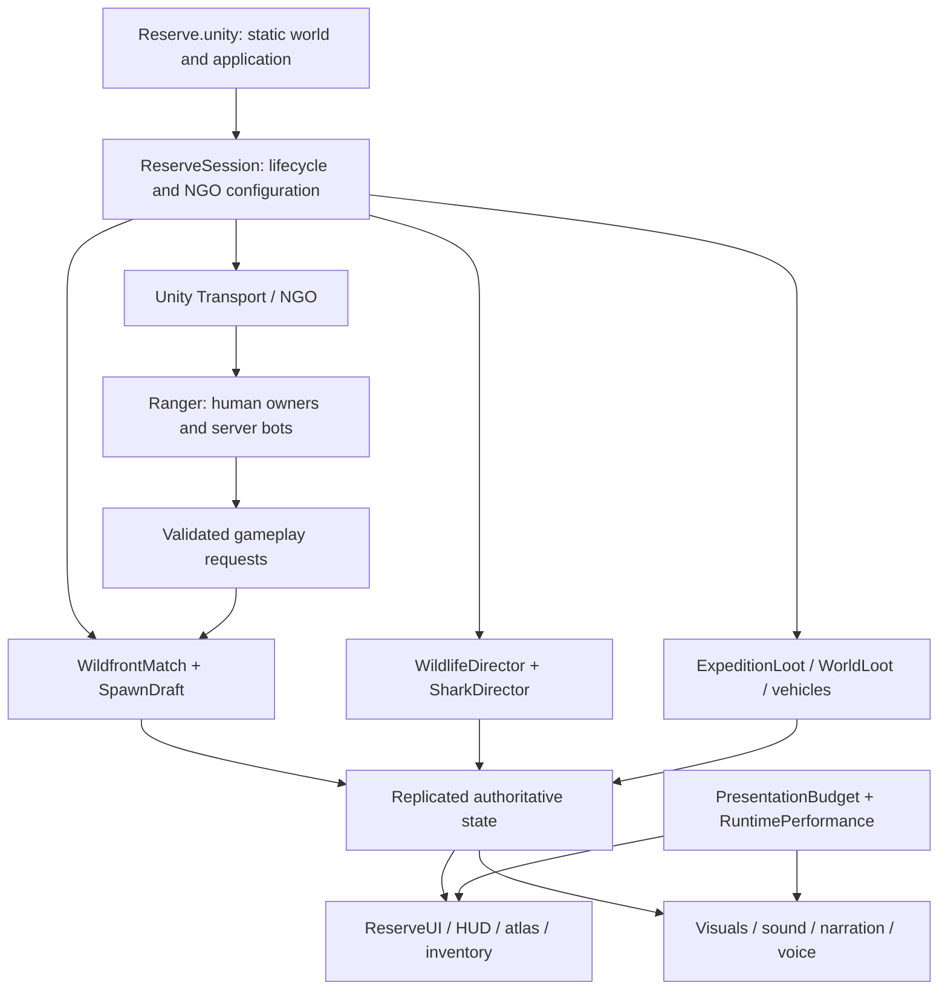

# Runtime architecture

**Active development is Unreal 5.6.1.** See [migration architecture and phases](../Design/UNREAL-MIGRATION.md) and [native module/class boundaries](../Unreal/Pinefall/README.md). This page records the frozen Unity implementation used as the migration reference.

## Execution model

Pinefall uses Unity's built-in render pipeline, GameObjects/MonoBehaviours, Netcode for GameObjects (NGO) and Unity Transport. It is a **listen-server** game: the host runs authoritative simulation and a local rendered player in one process. Guests render and send player requests; they do not run the full host AI/vehicle simulation. There is no dedicated-server product, relay, backend persistence or ECS implementation in this baseline.

## Lifecycle

1. Unity loads the committed reserve scene. `ReserveWorld.Awake` caches terrain heights before runtime foliage and actor sampling. Static settlement/terrain content is already in the scene; additional presentation is procedural.
2. `ReserveSession.Start` constructs the NGO manager/transport, registers prefabs, sets approval rules, wires connection events and adds the performance, voice, narration, discovery and interest managers.
3. Hosting starts a local server/client pair. Server initialization spawns shared weather, match and draft state, adds animal directors and populates loot/transport. A joined player is initialized as a `Ranger`.
4. `WildfrontMatch` owns round phases, storm timing, team victory and supply events. `SpawnDraft` owns bids, intent previews, turn order and validated landing selection. Team size is independent of each player's chosen landing point.
5. The owning human drives camera/input and owner-authoritative movement through `OwnerTransform`. Host logic owns health, hit/damage decisions, inventory mutations, wildlife and vehicle simulation. This mixed authority has security limits; it is not hardened competitive networking.
6. Leaving uses `LeaveRoutine`: release input/cursor, stop voice/narration state, remove population directors, clear interest registries, shut down NGO and restore the vista/preview. Static terrain and atlas stay loaded. Rehosting reuses them.

0.8 adds a replicated `ConstructionWorld`, network `BuildPiece` and `RocketProjectile` prefabs, bounded `ShotHistory`, and voice jitter/device playback. [Fieldcraft](FIELDCRAFT.md) describes their contracts and limits. `BuildReserve.BuildCurrent` prepares new resources without regenerating terrain.

## Main boundaries

### Session and match

`ReserveSession` owns connection state, transport configuration, local menu transition and resource-prefab registration. `WildfrontMatch` is a replicated round state machine; its partial definitions also contain supply and transport-map behavior. `SpawnDraft` is a separate network behavior. Avoid putting new persistent services directly into the round controller merely because it is globally reachable.

### Player domain

`Ranger` is a partial `NetworkBehaviour`, with survival, equipment, armor, rescue, water, camera and gun handling in companion files. Data is primarily `NetworkVariable` fields and packed bitfields. A change in one partial can affect inventory, bots, UI, dropped loot and the wire schema. Several method names retain earlier prototype terms; consult the current mod system before assuming what an upgrade does.

### World and content

`ExpeditionLayout` is the settlement/roads/mobility source. `ReserveBiomes` and `ReserveWater` describe habitats and water geometry; `ReserveUnderstory` supplies analytic editor terrain and fine foliage. `BuildReserve` and its editor partials generate the committed scene, assets and static features. Runtime cached terrain sampling must match the generated TerrainData rather than recalculate world generation for every actor.

### Simulation and presentation

`WildlifeDirector`, `Wildlife`, `SharkLife`, `HunterBot` and `RoadVehicle` run authoritative simulation. Render bodies, audio, decorative motion and camera behavior have separate ranges. `PresentationBudget` can hide/defer nearby models without destroying network state, collision or full-map transport information. Keep that distinction when adding an LOD system.

### UI and map

The UI uses **IMGUI** with manually positioned rectangles and shared drawing helpers; it is not currently UI Toolkit/uGUI. `ReserveUI` is partial across menu/HUD/atlas/guide files. `ReadableUI`/`RasterIcons` cache styles and pictograms. A UI Toolkit migration should proceed panel by panel behind the same gameplay actions, with input/cursor state and rendering cost measured.

The 4K terrain atlas is a baked image of the real world. Labels and live pins are overlays. Ordinary enemy player positions are hidden; team positions, permitted transport and short-lived team-only surveys use separate data paths.

### Networking and visibility

NGO replication is narrowed by `WorldInterest` to actors near remote viewpoints. The host retains all authoritative actors. A separate targeted 1 Hz transport feed preserves map information beyond render/interest range while omitting enemy-occupied vehicles. Visibility work is budgeted across frames. `Forget` cancels pending show work before despawn to avoid NGO 1.8 stale spawn queues.

## Structural debt and evolution

Source is intentionally kept in its existing layout for this import. Several files are dense, several singletons/static registries assume one active session, and numeric content IDs are positional. There are no custom assembly definitions, dependency injection container, save schema or generic item database yet.

First extract pure data/types and add behavior coverage, then introduce domain folders or assemblies one at a time. Preserve asset GUIDs and any `Resources` path. Avoid a simultaneous namespace/folder/network schema rewrite; use [DEVELOPMENT](DEVELOPMENT.md) and [ROADMAP](ROADMAP.md) for staged proposals.
