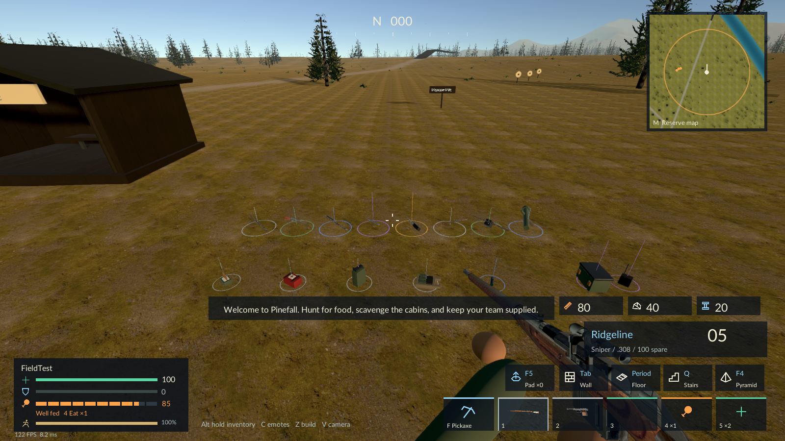
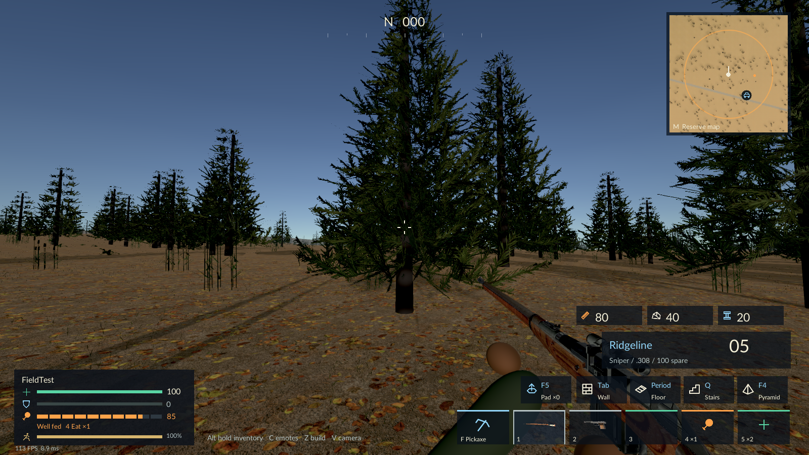

# Handling and presentation: 0.9.1

This pass improves the Unity baseline; it does not change engines or claim production-quality art throughout.

## Construction

Build aim uses the camera, with a six-degree dead band past a diagonal turn boundary. Nearby structures retain their grid frame when a downward ray misses an edited opening or during a jump. Feet must approach the next three-metre storey before the preview moves upward. Looking down toward an adjacent cell extends floors. Placement is revalidated when its target changes and while firing. Host material, support, reach, obstruction and ownership checks remain authoritative.

## Vehicle handling

The old hard height cutoff stopped a car on continuous slopes. Motion now permits graded ascent, slows on steep climbs, follows bridge/build support and rejects abrupt ledges. Obstacle checks use a bounded nonallocating buffer; saturated buffers fail closed. Expired driver input resets steering/brakes as well as throttle. Non-finite requests are rejected. Host rendering and the vehicle camera interpolate between physics poses; client network-transform interpolation remains in place.

The integration probe drives an occupied vehicle up a real 36-degree collider, in addition to the grade/ledge boundary checks. This is not certification of every route on the reserve. Deep water still requires boats; cliffs remain barriers.

## Ground equipment and pickup UI

`LootModels` reuses the existing imported rifle/pistol assets, adapts their silhouette by class, and uses the existing launcher assembly. Other supplies have differentiated original geometry: medical bags, exposed cartridges, fuel-can handles/caps, vests/plates, optical tubes, radios and latching caches. Those supplies remain procedural models, not newly purchased/scanned production props. The eight weapon classes do not yet each have a separately authored firearm asset.

Models/materials are shared and procedural pieces are combined per item type. Rarity is a small ring/thin locator rather than a saturated weapon recolor. Marker range is 105 m before adaptive scaling. Detailed item bodies enter at 38 m and leave at 44 m, with a quarter-second staggered check. Rings/locators share an instanced mesh and material rather than separate line renderers. Authoritative pickup state persists outside visual range. The right-side pickup card shows name/category/rarity and the active binding without filling the view with one long interaction line.

## World activity and image

Wildlife targets forty per available habitat, with a 320-live-animal ceiling. Relevant replenishment checks every four to seven seconds and aims for fourteen animals within 260 m of a human fighter; spawn buffers and other habitat rules can prevent that target. Groups remain outside ninety metres of players and inside the arena. No exact encounter count is promised.

Storm anomalies reuse replicated kind 11 cache items with item 1. Six/ten/fourteen candidate sites are attempted in small/medium/full arenas. During active matches, exposure within seven metres costs four health every two seconds, bypassing armor. Securing a cache removes the hazard and adds an epic weapon (80%) or legendary weapon (20%) to ordinary attachment/medicine/plate rewards. Blue motes are visual only; server hazard simulation is independent of visual culling.

Terrain/short grass use less saturated natural tints, stronger near normals and triplanar scanned stone on boulders/pebbles. Balanced ambient fill creates more directional form while keeping shaded gear readable. A small shared sky/ground reflection cube supplies metallic highlights without per-pickup lights or recurring probe captures. Lower haze and an edge-aware image resolve improve terrain/foliage clarity. This retains the built-in renderer and the existing asset mix; it is not a complete realistic-character/vehicle/animal art replacement.

## Engine decision

An Unreal migration should first establish one integrated two-player vertical slice under a lead: packaged host/join, movement, camera, weapons, authoritative damage and respawn. A second contributor can independently audit/import assets and animation/material workflows. Parallel feature ownership is safer after that baseline and its interfaces are stable. Unity C# gameplay and NGO networking need replacement; models/textures may be reusable. See [Epic's migration documentation](https://dev.epicgames.com/documentation/unreal-engine/migrating-assets-from-unity-to-unreal-engine).

Protocol review: no network variable/RPC layout, prefab registration or item-kind ID changes. Anomalies specialize an existing cache item. The wire protocol remains 9, but use matching 0.9.1 players for consistent presentation and handling.

## Actual rendered examples

These are native game captures. They show the remaining stylized/procedural art limitations as well as the changes; they are not concept art or a claimed AAA target.
